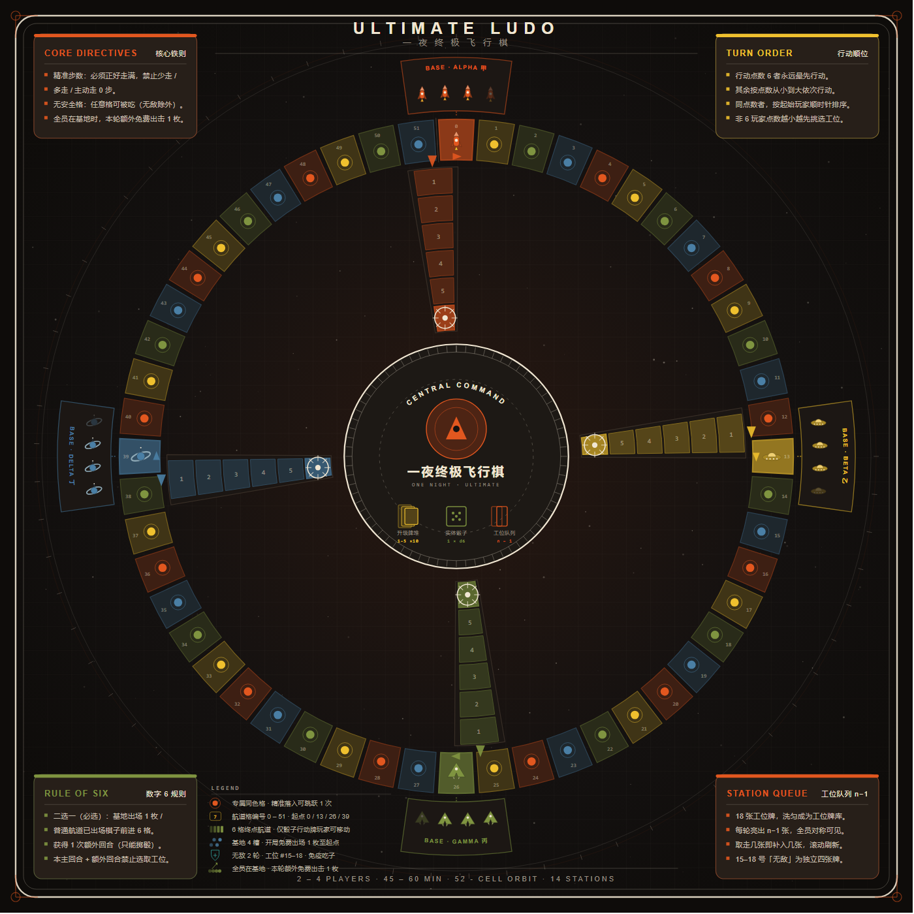
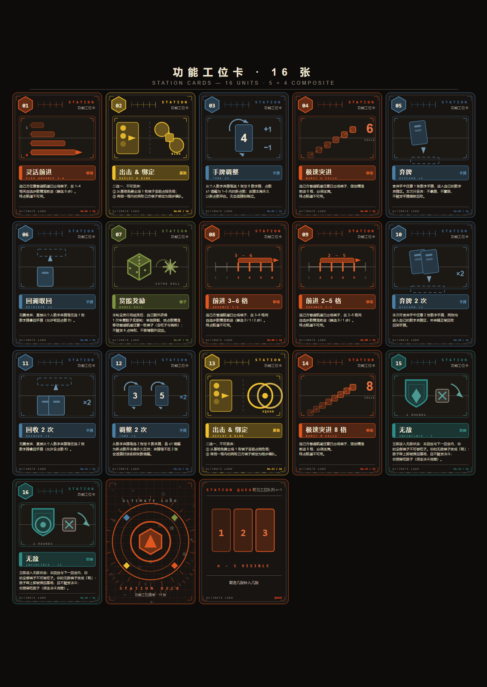
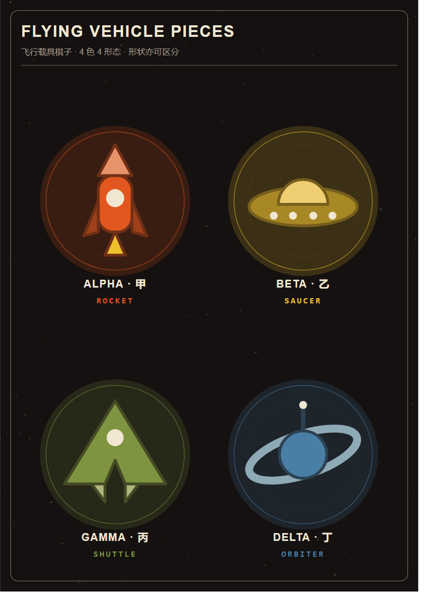

# 一夜终极飞行棋 · ULTIMATE AEROCHESS

> **同步暗牌 · 决斗吃子 · 工位博弈** —— 把童年飞行棋重做成一款「全员同时行动、靠脑子而不是靠骰子」的聚会策略游戏。
> 你以为你在掷骰子？不，你每一轮都在**同时亮牌、同步移动、抢夺工位、当面决斗**。





| 项目 | 参数 |
|---|---|
| 人数 | 2 – 4 人（最佳 3 – 4 人） |
| 时长 | 经典 4 子 45 – 60 分钟；极速单子 15 – 25 分钟 |
| 类型 | 同步行动 / 手牌管理 / 工位博弈 / 聚会轻中策 |
| 重度 | 2.3 – 2.6 / 5 |
| 机制完成度 | 7.1 / 10 |
| 组件 | 16 种功能工位 + 数字手牌 1–6 + 骰子行动牌 + 棋子 token |

---

## 一句话看懂

传统飞行棋轮流掷骰子，等人等到睡着。**本作全员同时暗藏手牌、一起亮牌、一起移动**：
你出的不是「走几步」，而是一整套**行动组合**——移动、跳格、抢工位、触发决斗。
谁先把全部棋子送进终点航道，谁就赢。

> 骰子还在，但它只是你手牌里的「一张牌」。真正决定胜负的，是出牌顺序与工位抢夺。

---

## 核心机制

- **全员同步暗牌揭示**：每轮所有人同时选牌、同时亮出，集体解析全部移动，彻底消灭轮流等待的 downtime。
- **手牌循环系统**：数字 1–6 全部打光才整组回收；骰子行动牌永久留手、每回合可复用；±1 升级牌独立置换、永久生效，闭环无漏洞。
- **n‑1 滚动窗口工位系统**：每轮固定 n‑1 张工位任你抢，取走几张补几张，牌库耗尽洗回循环；工位博弈是独立于棋子移动的第二战场。
- **决斗吃子（弱化版）**：落到敌人头上不再是秒杀，而是**翻开暗牌当面决斗**，平局进攻方胜——给防守方留出翻盘与心理博弈空间。
- **6 点二选一 + 代价绑定**：出场 / 突进二选一换额外回合，但当回合及额外回合禁止选工位，超模效果必有代价。
- **终点航道权限隔离**：绝大多数手牌与工位都无法操作终点航道棋子，**只有骰子牌能收官**，人为制造收官瓶颈，避免无脑冲线。

---

## 怎么玩

### 网页版（推荐，零安装）

纯前端单机游戏，**1 名玩家对 1–3 名 AI**，双击即玩：

```
一夜终极飞行棋/
└── web/
    └── index.html      ← 双击它，浏览器直接开打（file:// 已验证通过）
```

- 开局面板可选 **人数（2–4）**、**模式（经典 4 子 / 极速单子）**、**AI 难度（休闲 / 标准 / 硬核 / 极限）**。
- 也可部署到任意静态服务器或 GitHub Pages：`web/` 目录整体上传即可。

### 打印版（Print & Play）

`pnp/` 目录提供可直接送打印店的 PDF：

| 文件 | 内容 |
|---|---|
| `pnp_board_print.pdf` | 游戏主棋盘（A3 跨页） |
| `pnp_stations_print_p1.pdf` / `pnp_stations_print_p2.pdf` | 16 张功能工位卡（A4 双面） |
| `pnp_player_cards_print.pdf` | 数字手牌 + 骰子行动牌 + 升级牌 |
| `pnp_card_backs_print.pdf` | 卡背（双面打印用） |
| `pnp_pieces_print.pdf` | 棋子 / 基地 / 标记 token |
| `components/` | 上述各组件的 SVG / PNG 原图，可自改自印 |

最终规则书：

- 排版版 PDF：[`rulebook/一夜终极飞行棋_规则书.pdf`](rulebook/一夜终极飞行棋_规则书.pdf)
- 图文互动版 HTML（含配图，单文件可直接打开）：[`rulebook/一夜终极飞行棋_规则书_图文版.html`](rulebook/一夜终极飞行棋_规则书_图文版.html)

---

## 两种模式

- **经典 4 子**：每人 4 枚棋子，全部抵达终点航道获胜，45–60 分钟，策略纵深最足。
- **极速单子**：每人 1 枚棋子，节奏更快，15–25 分钟，适合茶余饭后一局。

---

## 文件结构

```
一夜终极飞行棋/
├── README.md                       # 本文件
├── rulebook/                       # 最终规则书（PDF + 图文 HTML）
├── web/                            # 可游玩网页版（1 vs AI，纯前端）
│   └── index.html
└── pnp/                            # 打印素材
    ├── pnp_board_print.pdf
    ├── pnp_stations_print_p1.pdf
    ├── pnp_stations_print_p2.pdf
    ├── pnp_player_cards_print.pdf
    ├── pnp_card_backs_print.pdf
    ├── pnp_pieces_print.pdf
    └── components/                 # 组件原图（SVG/PNG）
```

---

## 许可

个人非商业用途 freely 使用、打印与修改；请勿用于商业售卖。
本作为原创桌游设计，规则书与美术版权归作者所有。
